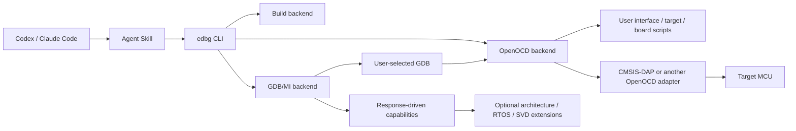

# EmbeddedDebug-Skill

[](https://github.com/tangsangsimida/embedded-debug-skill/actions/workflows/ci.yml)

Install the Skill into Codex or Claude Code with the Skills CLI:

```sh
npx skills add tangsangsimida/embedded-debug-skill --skill embedded-debug -a codex -g -y
npx skills add tangsangsimida/embedded-debug-skill --skill embedded-debug -a claude-code -g -y
```

Requirements: Python 3.11+ for the CLI. Hardware operations additionally require user-installed OpenOCD, a GDB matching the target architecture, and an adapter/target configuration already used by the project. Skill installation does not install or modify system toolchains. The version-checking launcher can install the matching immutable GitHub commit after user authorization; the current candidate is pinned to the published source commit and is not a stable release. `edbg doctor` works even if the embedded toolchain is missing. Linux is the validated host; other operating systems are not yet verified.

Ask your agent: “Use EmbeddedDebug Skill to inspect my OpenOCD environment and connect using the current project's configuration. Read CPU registers and the current backtrace.” The agent should check first, use your OpenOCD files and matching GDB, then report exact errors or observed output. Flashing, reset, and writes require explicit authorization.

## What works in 0.1.0

- System-first PATH discovery and version checks with bounded subprocess timeouts.
- Strict project TOML configuration and loopback-only OpenOCD default.
- OpenOCD process management, config file composition, port reuse detection, logging, and cleanup.
- Persistent serialized GDB/MI2 transport with token matching, nested result parsing, async record routing, timeout handling, and disconnect errors.
- Generic GDB controller primitives for target selection, architecture/register discovery, expression reads, stack frames, breakpoints, and run-state tracking.
- Agent Skill metadata and resource validation. Skills CLI repository-install tests are an explicit release gate.

The published package CLI is an early integration layer. See [Known limitations](#known-limitations); not every listed CLI surface is wired to persistent sessions yet. No physical hardware validation is claimed.

## Architecture



The support boundary is OpenOCD plus the configured GDB architecture and observed capabilities, not a chip-vendor list. No target configuration is bundled as a compatibility requirement. GDB backends and architecture diagnostics have extension boundaries; the first implementation defaults to ARM GNU GDB.

## Install the Python CLI

After a stable release is available and the user authorizes it, the Skill wrapper can install the CLI from that exact Git tag:

```sh
python3 <installed-skill-directory>/scripts/run_edbg.py --install-python-cli doctor --json
```

Or install it into your chosen Python environment from the immutable source commit pinned in the installed Skill launcher. Then run `edbg --help`, `edbg --version`, and `edbg doctor --json`. The Skills CLI installs Skill files; it does not install `edbg`, GDB, OpenOCD, or USB drivers. System tools remain user-managed.

## Quick start

Start in the existing project workspace:

```sh
edbg discover --json
edbg doctor --json
edbg connect --elf build/firmware.elf
```

Discovery checks existing VS Code launch/tasks, CMake/Make/PlatformIO files, ELF outputs, and local GDB Server ports. An existing server is reused. If one project setting is genuinely unclear, pass only that setting explicitly. A complete OpenOCD config or user-provided interface/target scripts remain supported:

```sh
edbg --json connect \
  --interface interface/cmsis-dap.cfg \
  --target target/your-target.cfg \
  --elf build/firmware.elf
```

Or use a complete OpenOCD config and a different GDB executable:

```sh
edbg --json --gdb /path/to/gdb --openocd /path/to/openocd connect \
  --openocd-config debug/openocd.cfg --elf build/firmware.elf
```

A complete config can also contain adapter, target, board, flash driver, and initialization commands. The CLI defaults to `127.0.0.1`, and rejects non-loopback binds. `--reuse-server` avoids starting a second local OpenOCD server.

## Environment and configuration

Use `edbg doctor --json` to inspect Python, ARM GCC, ARM GDB, OpenOCD, objcopy, size, and discovered project settings. GDB/OpenOCD are optional until a connected operation needs them. `--verbose` includes executable names. Explicit CLI paths override optional TOML, which overrides PATH discovery. Missing tools produce diagnostics; no downloads or environment modifications occur. For supported Linux shells, doctor prints a PATH suggestion only; Bash/Zsh use `export PATH="/your/toolchain/bin:$PATH"`, fish uses `fish_add_path /your/toolchain/bin`. The path is illustrative; do not copy it without replacing it.

TOML configuration is optional and strict. Unknown fields, invalid ports, and non-loopback OpenOCD hosts are rejected. Build commands are argv arrays, not shell strings. Examples in `configs/` are demonstrations only. In particular, `gd32e5-template.toml` makes no claim that a GD32E5 target is supported or that STM32 OpenOCD scripts are interchangeable.

## Debugging interfaces

```sh
edbg --help
edbg discover --json
edbg doctor --json
edbg config validate --json
edbg session start
edbg registers --json
edbg backtrace --json
edbg variable read motor_speed --json
edbg breakpoint add main --json
edbg session stop
```

When no existing launch configuration or server is found, pass the user's existing OpenOCD config, interface/target scripts, GDB executable, and ELF. A session starts/reuses OpenOCD and stores ownership metadata; each CLI operation reconnects GDB/MI to that server. Session status reports target state as unknown unless the active GDB operation has observed it.

The Python GDB controller exposes register, expression, frame, and breakpoint operations. Capability values are confirmed from GDB/OpenOCD responses; where the backend cannot probe safely, it reports `unknown`. The current command-line session orchestration is incomplete and is documented under limitations.

## Agent installation, update, and removal

One-line installation uses [Vercel's Skills CLI](https://www.skills.sh/docs/cli), which installs the standard `SKILL.md` folder into detected agent skill locations:

```sh
npx skills add tangsangsimida/embedded-debug-skill --skill embedded-debug -a codex -g -y
npx skills add tangsangsimida/embedded-debug-skill --skill embedded-debug -a claude-code -g -y
npx skills update embedded-debug -g -y
npx skills remove embedded-debug -a codex -g -y
```

Skills CLI installation and Python CLI installation are separate operations. This project does not claim that installing the Skill automatically installs the Python package. After installation, invoke the agent with a natural language debugging request; it discovers the Skill through the platform’s installed Skill directory. CI verifies filesystem installation and a command-call contract, not LLM natural-language activation.

## STM32F407 example

`configs/stm32f407.example.toml` shows one common setup using the OpenOCD scripts already installed on the user’s system. Check that those exact interface/target files exist in the local OpenOCD scripts directory; configure the ELF and GDB version for the project. This is an example configuration, not a tested hardware support promise.

## Other targets and adapters

Change only the OpenOCD config paths and, when necessary, select a GDB that understands the architecture. No Python source edit or project target allowlist is required. An interface can be CMSIS-DAP v1/v2 or any adapter supported by the selected OpenOCD build. The service must actually connect and GDB must identify the architecture. Never infer GD32E5 compatibility from STM32 support.

## RTOS, SVD, faults, and telemetry

- **ThreadX:** generic GDB threads are not proof of RTOS awareness. The release does not claim a validated ThreadX decoder.
- **HardFault:** a correct Cortex-M analysis needs exception-frame interpretation and SCB registers; current CLI does not yet implement a validated decoder.
- **SVD:** no safe peripheral bulk reader is enabled in this release. SVD is an optional future extension.
- **Telemetry:** GDB reads while halted are stop-mode inspection, not non-intrusive real-time telemetry. RTT/UART backends are not included in the current release.

## Safety

Read-only inspection is the default. Explicit user authorization is required before programming/erasing flash, reset, memory or register writes, executing firmware that may control actuators, and bulk hardware tests. Never disable emergency stops, interlocks, or protection logic. Keep OpenOCD bound to loopback. Changes should be auditable. Do not use a successful build or mock result as proof of physical behavior.

## Validation status and roadmap

The repository includes unit/Mock tests and CI for package build, lint, types, tests, Skill validation, and isolated Skills CLI installs for Codex and Claude Code. Stable Release is additionally blocked by `release-readiness.toml` until the remaining acceptance items are complete and has no release tag yet. Hardware tests require explicit opt-in and user-supplied config and are skipped by default. Current development host has ARM GCC and OpenOCD but lacks `arm-none-eabi-gdb`; no physical probe test has been run.

Next: complete persistent-session CLI orchestration; implement safe memory access, flash/verify/reset with authorization and audit; architecture plugin API and evidence-based capabilities; ELF/DWARF source mapping and HardFault decoding; safe SVD reads; ThreadX/OpenOCD compatibility matrix; serial telemetry; release artifact install smoke test.

See [architecture](docs/architecture.md), [installation](docs/installation.md), [configuration](docs/configuration.md), [CLI reference](docs/cli-reference.md), and [troubleshooting](docs/troubleshooting.md).
