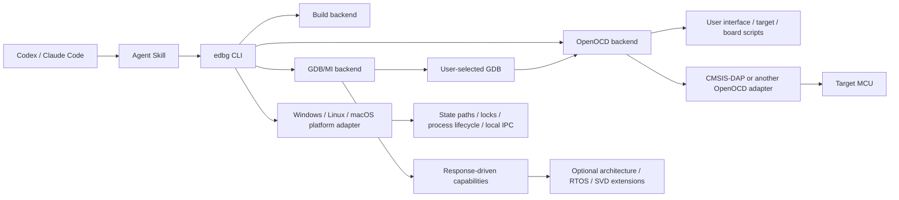

# EmbeddedDebug-Skill

[](https://github.com/tangsangsimida/embedded-debug-skill/actions/workflows/ci.yml)

Install the Skill into Codex or Claude Code with the Skills CLI:

```sh
npx skills add tangsangsimida/embedded-debug-skill --skill embedded-debug -a codex -g -y
npx skills add tangsangsimida/embedded-debug-skill --skill embedded-debug -a claude-code -g -y
```

Requirements: Python 3.11+ for the CLI. Hardware operations additionally require user-installed OpenOCD, a GDB matching the target architecture, and a working project debug setup. Skill installation does not install or modify system toolchains. The current development candidate is not a stable release. `edbg doctor` works even if the embedded toolchain is missing. CI uses Python 3.11 as its compatibility baseline across multiple Linux, Windows, and macOS releases and x64/arm64 runners. This does not claim physical USB adapter or MCU validation on any platform.

| Platform | Python 3.11 CLI + Mock CI runners | USB adapter / physical MCU |
|---|---|---|
| Linux x64 | Ubuntu 24.04, 26.04 | Not hardware validated |
| Linux arm64 | Ubuntu 24.04 | Not hardware validated |
| Windows x64 | Server 2022, Server 2025 | Not hardware validated |
| Windows arm64 | Windows 11 arm64 | Not hardware validated |
| macOS Intel | macOS 15 Intel | Not hardware validated |
| macOS arm64 | macOS 15, 26 | Not hardware validated |

Ask your agent: “Use EmbeddedDebug Skill to inspect my OpenOCD environment and connect using the current project's configuration. Read CPU registers and the current backtrace.” The agent should check first, use your OpenOCD files and matching GDB, then report exact errors or observed output. Flashing, reset, and writes require explicit authorization.

## Current implementation

- System-first PATH discovery and version checks with bounded subprocess timeouts.
- Independent environment inspection and non-mutating remediation plans; an explicitly authorized Python CLI install uses a versioned user cache and never changes system tools or shell startup files.
- Optional strict project TOML overrides and loopback-only OpenOCD default.
- OpenOCD process management, config file composition, port reuse detection, logging, and cleanup.
- Project discovery for existing VS Code launch/tasks, OpenOCD arguments, build commands, and ELF outputs. A standalone target file and `.edbg.toml` are not required if existing project settings define the path.
- Persistent serialized GDB/MI2 transport with token matching, nested result parsing, async record routing, timeout handling, and disconnect errors.
- Persistent cross-process GDB/MI session, so breakpoints and selected thread survive separate `edbg` commands. Existing local GDB Servers are reused automatically and checked through GDB.
- Cross-platform state/cache directories, process identity and cleanup, interprocess locks, and authenticated loopback IPC; separate `--session <name>` contexts isolate multiple targets.
- Generic GDB controller primitives for target selection, architecture/register discovery, expression reads, stack frames, breakpoints, thread selection, and run-state tracking.
- Agent Skill metadata and resource validation. Skills CLI repository-install tests are an explicit release gate.

This is a candidate build; no stable Release or physical hardware validation is claimed. See [Validation status and roadmap](#validation-status-and-roadmap) for known limits.

## Architecture



The support boundary is OpenOCD plus the configured GDB architecture and observed capabilities, not a chip-vendor list. No target configuration is bundled as a compatibility requirement. GDB backends and architecture diagnostics have extension boundaries; the first implementation defaults to ARM GNU GDB.

## Install the Python CLI

After user authorization, the Skill wrapper installs the CLI version pinned in the installed Skill. The current development candidate is not a stable Release:

```sh
python <installed-skill-directory>/scripts/run_edbg.py --install-python-cli doctor --json
```

Or install it into your chosen Python environment from the immutable source commit pinned in the installed Skill launcher. Then run `edbg --help`, `edbg --version`, and `edbg doctor --json`. The Skills CLI installs Skill files; it does not install `edbg`, GDB, OpenOCD, or USB drivers. System tools remain user-managed.

## Quick start

Start in the existing project workspace:

```sh
edbg discover --json
edbg doctor --json
edbg environment inspect --json
edbg environment plan --json
edbg --session bench-a connect --elf build/firmware.elf
edbg --session bench-a registers --json
```

Discovery checks existing VS Code launch/tasks, OpenOCD command arguments, CMake/Make/PlatformIO files, ELF outputs, and common local GDB Server ports. An existing server is reused automatically and validated with GDB. If one project setting is genuinely unclear, pass only that setting explicitly. A standalone `.edbg.toml` or target.cfg is unnecessary when the existing project setup already provides the target path. A complete OpenOCD config or user-provided interface/target scripts remain supported:

```sh
edbg --json connect \
  --interface interface/cmsis-dap.cfg \
  --target target/your-target.cfg \
  --elf build/firmware.elf
```

Or use a complete OpenOCD config and a different GDB executable:

```sh
edbg --json --gdb /path/to/gdb --openocd /path/to/openocd connect \
  --openocd-config debug/openocd.cfg --elf build/firmware.elf
```

A complete config can also contain adapter, target, board, flash driver, and initialization commands. The CLI defaults to `127.0.0.1`, and rejects non-loopback binds. If no local GDB Server is listening, it starts OpenOCD only from the project's discovered or explicitly supplied configuration.

## Environment and configuration

Use `edbg doctor --json` to inspect Python, ARM GCC, ARM GDB, OpenOCD, objcopy, size, and discovered project settings. GDB/OpenOCD are optional until a connected operation needs them. `--verbose` includes executable names. Explicit CLI paths override optional TOML, which overrides PATH discovery. Missing tools produce diagnostics; no downloads or environment modifications occur. Doctor prints only a PATH suggestion: Bash/Zsh use `export PATH="/your/toolchain/bin:$PATH"`, fish uses `fish_add_path /your/toolchain/bin`, PowerShell uses `$env:Path = "C:\\toolchain\\bin;$env:Path"`, and CMD uses `set "PATH=C:\\toolchain\\bin;%PATH%"`. Replace the illustrative directory with the actual toolchain location.

TOML configuration is optional and strict. Unknown fields, invalid ports, and non-loopback OpenOCD hosts are rejected. Build commands are argv arrays, not shell strings. Examples in `configs/` are demonstrations only. In particular, `gd32e5-template.toml` makes no claim that a GD32E5 target is supported or that STM32 OpenOCD scripts are interchangeable.

## Debugging interfaces

```sh
edbg --help
edbg discover --json
edbg doctor --json
edbg config validate --json
edbg session start
edbg registers --json
edbg backtrace --json
edbg variable read motor_speed --json
edbg breakpoint add main --json
edbg session stop
```

When discovery finds an existing launch configuration or server, `edbg connect` can use it without repeating its settings. A session reuses the running GDB Server, stores ownership metadata, and keeps one GDB/MI process for subsequent CLI operations. `edbg session cancel --authorize-run` can interrupt a stalled GDB command from another terminal and may halt target execution. Recovery reconnects GDB without restarting OpenOCD; restarting a failed OpenOCD instance requires `--authorize-openocd-restart`.

The Python GDB controller exposes register, expression, frame, breakpoint, thread-selection, and memory operations. Capability values are confirmed from GDB/OpenOCD responses; where the backend cannot probe safely, it reports `unknown`.

## Agent installation, update, and removal

One-line installation uses [Vercel's Skills CLI](https://www.skills.sh/docs/cli), which installs the standard `SKILL.md` folder into detected agent skill locations:

```sh
npx skills add tangsangsimida/embedded-debug-skill --skill embedded-debug -a codex -g -y
npx skills add tangsangsimida/embedded-debug-skill --skill embedded-debug -a claude-code -g -y
npx skills update embedded-debug -g -y
npx skills remove embedded-debug -a codex -g -y
```

Skills CLI installation and Python CLI installation are separate operations. This project does not claim that installing the Skill automatically installs the Python package. After installation, invoke the agent with a natural language debugging request; it discovers the Skill through the platform’s installed Skill directory. CI verifies filesystem installation and a command-call contract, not LLM natural-language activation.

## STM32F407 example

`configs/stm32f407.example.toml` shows one common setup using the OpenOCD scripts already installed on the user’s system. Check that those exact interface/target files exist in the local OpenOCD scripts directory; configure the ELF and GDB version for the project. This is an example configuration, not a tested hardware support promise.

## Other targets and adapters

Change only the OpenOCD config paths and, when necessary, select a GDB that understands the architecture. No Python source edit or project target allowlist is required. An interface can be CMSIS-DAP v1/v2 or any adapter supported by the selected OpenOCD build. The service must actually connect and GDB must identify the architecture. Never infer GD32E5 compatibility from STM32 support.

## RTOS, SVD, faults, and telemetry

- **ThreadX:** generic GDB threads are not proof of RTOS awareness. The release does not claim a validated ThreadX decoder.
- **HardFault:** a correct Cortex-M analysis needs exception-frame interpretation and SCB registers; current CLI does not yet implement a validated decoder.
- **SVD:** no safe peripheral bulk reader is enabled in this release. SVD is an optional future extension.
- **Telemetry:** GDB reads while halted are stop-mode inspection, not non-intrusive real-time telemetry. RTT/UART backends are not included in the current release.

## Safety

Read-only inspection is the default. Explicit user authorization is required before programming/erasing flash, reset, memory or register writes, executing firmware that may control actuators, and bulk hardware tests. Never disable emergency stops, interlocks, or protection logic. Keep OpenOCD bound to loopback. Changes should be auditable. Do not use a successful build or mock result as proof of physical behavior.

## Validation status and roadmap

The v0.1.0 minimum scope is project/tool discovery, GDB-verified OpenOCD connections, persistent GDB/MI inspection and guarded run control, system-first environment diagnostics, and validated Codex/Claude Skills installation. Advanced HardFault, RTOS/ThreadX, SVD, and telemetry diagnostics are roadmap items, not release blockers or current support claims. This candidate adds an executable opt-in HIL runner, but no source-level physical hardware test has been run yet.

The repository includes unit/Mock tests and Windows, Linux, and macOS CI for package build, lint, types, tests, Skill validation, and isolated Skills CLI installs for Codex and Claude Code. The release workflow also installs the exact release wheel on every platform/agent matrix before applying the stable-release gate. Stable Release is blocked by `release-readiness.toml` until the physical candidate HIL evidence and exact artifact install gates pass. Hardware tests require explicit opt-in and a user-supplied config and are skipped by default.

Roadmap: validated architecture-specific HardFault decoding, safe SVD reads, ThreadX/OpenOCD compatibility testing, and serial/RTT telemetry.

See [architecture](docs/architecture.md), [installation](docs/installation.md), [configuration](docs/configuration.md), [CLI reference](docs/cli-reference.md), and [troubleshooting](docs/troubleshooting.md).
